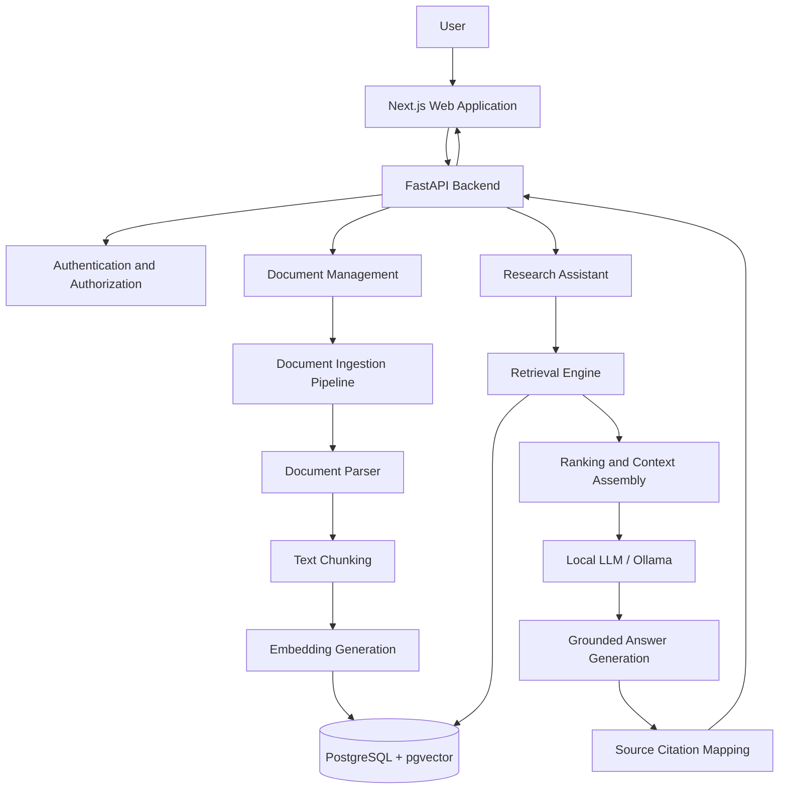
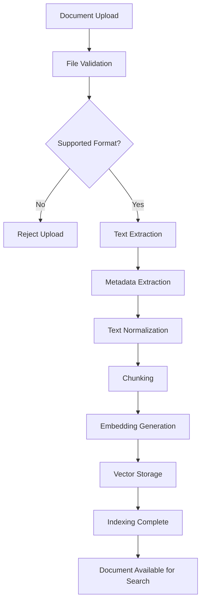
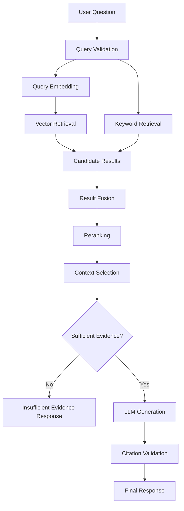
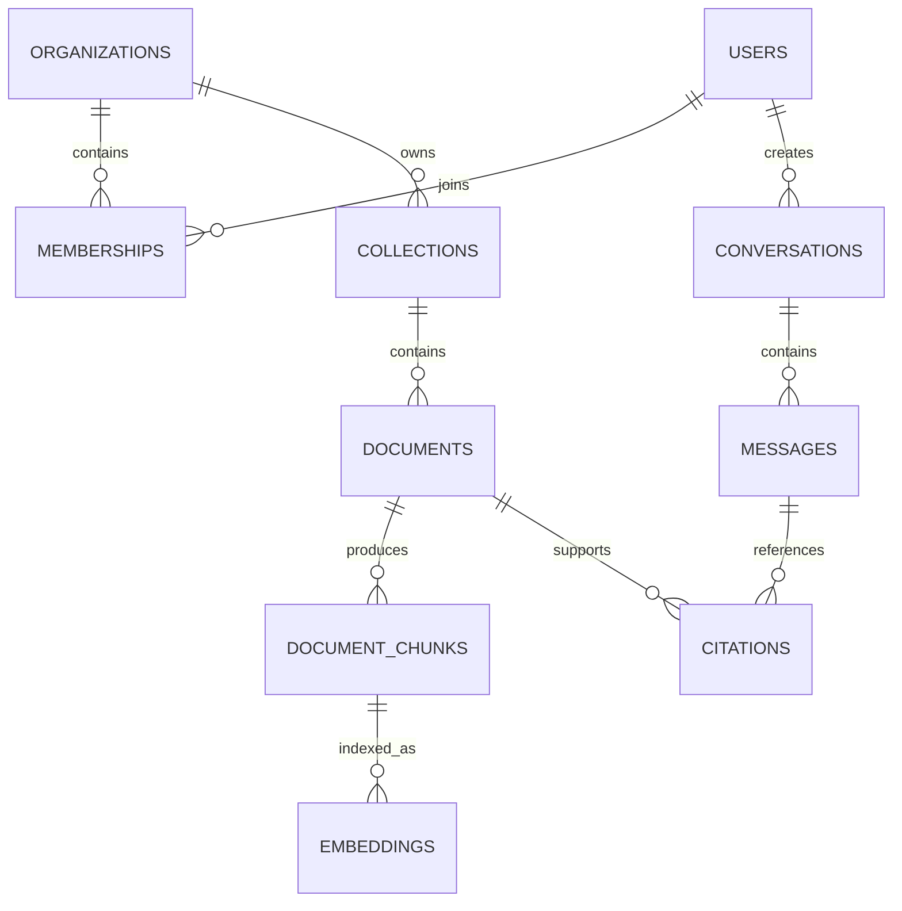

# ❤️ Support Independent Development

If you find this project valuable and would like to support its development, research, infrastructure and future improvements, you can contribute here:

**[☕ Support AURA Development – Razorpay](https://razorpay.me/@adityanarayanrautaray)**

Every contribution helps support independent engineering and open-source development.

---

# AURA — Private AI Research Intelligence

### Your Knowledge. Your Intelligence. Your Control.

**A privacy-focused, AI-powered document intelligence and research platform designed to help businesses, researchers and technical teams retrieve reliable information from large document collections.**

<p align="center">

  
  
  
  
  
  
  

</p>

<p align="center">

  **Independently designed and developed by Aditya Narayan Rautaray.**

</p>

> **Current implementation:** A locally runnable MVP supports account sign-in, document upload and deletion, passage search, and evidence-backed answers with citations. See [IMPLEMENTATION_STATUS.md](./IMPLEMENTATION_STATUS.md) for verified scope, setup notes, and remaining validation.

---

## 1. Introduction

AURA (Private AI Research Intelligence) is an AI-driven document intelligence platform intended to transform how individuals, businesses and research teams interact with large collections of information.

Modern organizations accumulate enormous amounts of information across:

- Research papers
- Technical documentation
- Business reports
- Financial documents
- Internal knowledge bases
- Legal and compliance documents
- Project documentation
- Policies and operational manuals

Traditional document management systems primarily focus on storing and organizing information. Searching through large collections and extracting reliable answers still requires considerable human effort.

AURA aims to solve this problem by combining:

- Document processing
- Semantic search
- Vector embeddings
- Retrieval-Augmented Generation (RAG)
- Large Language Models (LLMs)
- Source-grounded answer generation
- Privacy-oriented local AI inference

Instead of simply generating answers from an LLM's general knowledge, AURA retrieves relevant information from the user's authorized document collection and uses that information to construct evidence-backed responses.

**The central principle of AURA is simple:**

> Intelligence should be useful, answers should be verifiable, and private information should remain under the user's control.

## 2. The Problem

Existing approaches to document research have several limitations.

### 2.1 Information fragmentation

Information is distributed across PDFs, Word documents, spreadsheets, reports and other file formats.

### 2.2 Inefficient retrieval

Traditional keyword-based searches frequently fail to identify relevant information when users express queries differently from the original document wording.

### 2.3 Unreliable AI responses

General-purpose AI assistants may generate plausible but unsupported answers, especially when responding to questions about specialized internal information.

### 2.4 Lack of traceability

Users need to know where an answer originated, which document supports it and which page contains the relevant information.

### 2.5 Privacy concerns

Businesses and researchers may be unable or unwilling to upload confidential information to third-party AI services.

### 2.6 Limited research workflows

Most basic document-chat applications do not provide sufficient retrieval evaluation, source management, document organization or administrative controls.

## 3. The Proposed Solution

AURA provides a unified document intelligence environment.

Users will be able to upload documents, organize them into knowledge collections, ask natural-language questions and receive answers supported by retrieved document passages.

### Core workflow

1. Upload documents.
2. Extract text and document metadata.
3. Divide documents into meaningful chunks.
4. Generate vector embeddings.
5. Store document chunks and embeddings.
6. Search using semantic and keyword retrieval.
7. Retrieve the most relevant passages.
8. Generate an answer using an LLM.
9. Display source citations and page references.
10. Allow users to inspect the supporting evidence.

AURA will support local AI inference as a primary privacy-oriented option, with the architecture designed to allow additional inference providers in the future.

---

# 4. Project Objectives

The primary objectives are:

| Objective | Description |
|---|---|
| Intelligent retrieval | Retrieve information using natural-language queries |
| Source-grounded responses | Provide evidence and document references |
| Privacy | Support locally executed AI components |
| Scalability | Handle growing document collections |
| Multi-user support | Isolate user and organizational information |
| Extensibility | Support different embedding and LLM providers |
| Reliability | Evaluate retrieval and answer quality |
| Usability | Provide an intuitive research interface |
| Reproducibility | Maintain repeatable ingestion and evaluation workflows |

## 5. Core Features

The following describes the intended product scope. Features will be marked complete only after implementation and testing.

### 5.1 Document Management

Supported initial document formats:

- PDF
- DOCX
- TXT
- Markdown

Planned capabilities:

- Multi-document uploads
- Document previews
- Document metadata extraction
- Collection-based organization
- Document deletion
- Re-indexing
- Processing status
- Duplicate detection
- File validation
- Document version tracking

Future extensions may include scanned PDFs, OCR, HTML and spreadsheet processing.

### 5.2 Intelligent Document Processing

The processing pipeline will:

- Extract document text.
- Preserve page-level metadata.
- Normalize extracted content.
- Identify document boundaries.
- Divide text into manageable chunks.
- Generate embeddings.
- Store chunks and associated metadata.

The ingestion pipeline will be designed to support background processing as document volumes increase.

### 5.3 Semantic Search

Users will be able to search for information based on meaning rather than exact keyword matches.

Planned capabilities:

- Natural-language search
- Vector similarity search
- Keyword search
- Hybrid retrieval
- Metadata filtering
- Relevance ranking
- Configurable retrieval parameters

### 5.4 AI Research Assistant

AURA will provide an interactive interface for asking questions about uploaded documents.

Planned capabilities:

- Context-aware questions
- Multi-turn conversations
- Document-specific queries
- Collection-specific queries
- Source-linked responses
- Follow-up questions
- Conversation history
- Evidence inspection

The system should distinguish between information found in documents and information it cannot establish from available evidence.

### 5.5 Source Citations

Citation accuracy is a core product requirement.

Each answer should provide:

- Source document name
- Page number, when available
- Relevant passage
- Source reference
- Link to the document or relevant preview

Citations should refer to the actual retrieved evidence, not merely documents associated with the conversation.

### 5.6 Local AI Processing

AURA will prioritize local AI execution.

Initial inference components:

- Ollama for local LLM execution
- Sentence Transformers for embedding generation
- PostgreSQL with pgvector for vector storage

The application should not require a third-party AI API key for its local inference configuration.

Additional cloud-based inference providers may be supported through optional adapters in the future.

### 5.7 Multi-User Architecture

The application is intended to support multiple users and organizations.

Planned functionality:

- User registration and authentication
- Organization workspaces
- Knowledge collections
- Role-based access control
- Document-level permissions
- Isolated conversations
- Audit events
- Administrative controls

No user should be able to retrieve another user's documents without explicit authorization.

### 5.8 Evaluation and Analytics

AURA will include an evaluation framework to measure the quality of its retrieval and answer-generation components.

Planned metrics:

- Recall@K
- Precision@K
- Mean Reciprocal Rank (MRR)
- Normalized Discounted Cumulative Gain (NDCG)
- Answer faithfulness
- Citation correctness
- Retrieval latency
- End-to-end response latency

Evaluation should use a documented test dataset containing questions, expected evidence and reference answers.

---

# 6. System Architecture

AURA follows a modular architecture that separates presentation, backend services, document processing, retrieval, inference and data persistence.

## 6.1 High-Level Architecture



## 6.2 Architecture Layers

| Layer | Responsibility |
|---|---|
| Presentation | User interface and research workflows |
| API | Request handling and validation |
| Authentication | Identity and access control |
| Document processing | Extraction, normalization and chunking |
| Embedding engine | Vector representation generation |
| Retrieval | Semantic and keyword search |
| Reranking | Relevance optimization |
| Generation | Evidence-grounded answer generation |
| Storage | Documents, metadata, vectors and conversations |
| Evaluation | Retrieval and answer-quality measurement |

## 6.3 Document Ingestion Pipeline



Every processing stage should maintain document ownership, processing status and error information.

## 6.4 Retrieval-Augmented Generation Pipeline



The system must be able to abstain when retrieved evidence is insufficient.

---

# 7. Technology Stack

AURA will use an intentionally selected technology stack rather than adopting frameworks without a clear engineering reason.

## 7.1 Backend

| Technology | Purpose |
|---|---|
| Python 3.11+ | Primary application language |
| FastAPI | REST API development |
| Pydantic | Data validation |
| SQLAlchemy | Database interaction |
| Alembic | Database migrations |
| PyMuPDF | PDF processing |
| python-docx | DOCX processing |
| Pytest | Automated testing |

## 7.2 AI and Machine Learning

| Technology | Purpose |
|---|---|
| Sentence Transformers | Text embeddings |
| Ollama | Local LLM inference |
| Hugging Face | Model ecosystem |
| PyTorch | ML execution where required |
| pgvector | Vector similarity search |
| RAG evaluation framework | Retrieval and answer evaluation |

The initial embedding model and LLM will be selected through benchmarking rather than assumed to be optimal.

## 7.3 Database

**PostgreSQL + pgvector**

The database will store:

- Users
- Organizations
- Memberships
- Documents
- Document chunks
- Embeddings
- Collections
- Conversations
- Messages
- Citations
- Processing jobs
- Audit events

PostgreSQL provides relational persistence, while pgvector enables vector similarity search within the same database.

## 7.4 Frontend

| Technology | Purpose |
|---|---|
| Next.js | Web application |
| React | Component architecture |
| TypeScript | Type safety |
| Tailwind CSS | Styling |
| Framer Motion | Interface animations |
| Lucide | Iconography |

## 7.5 Infrastructure

| Technology | Purpose |
|---|---|
| Docker | Containerization |
| Docker Compose | Local service orchestration |
| GitHub Actions | CI/CD |
| PostgreSQL backups | Data recovery |
| Structured logging | Application observability |

---

# 8. Repository Structure

The proposed monorepo structure:

```text
AURA-Private-AI-Research-Intelligence/
│
├── apps/
│   │
│   ├── api/
│   │   ├── app/
│   │   │   ├── api/
│   │   │   │   └── v1/
│   │   │   │       ├── auth.py
│   │   │   │       ├── documents.py
│   │   │   │       ├── collections.py
│   │   │   │       ├── search.py
│   │   │   │       ├── conversations.py
│   │   │   │       └── health.py
│   │   │   │
│   │   │   ├── core/
│   │   │   │   ├── config.py
│   │   │   │   ├── security.py
│   │   │   │   └── logging.py
│   │   │   │
│   │   │   ├── models/
│   │   │   ├── schemas/
│   │   │   ├── services/
│   │   │   ├── repositories/
│   │   │   ├── dependencies/
│   │   │   └── main.py
│   │   │
│   │   ├── tests/
│   │   └── pyproject.toml
│   │
│   └── web/
│       ├── src/
│       │   ├── app/
│       │   ├── components/
│       │   ├── hooks/
│       │   ├── lib/
│       │   ├── services/
│       │   └── types/
│       │
│       └── package.json
│
├── packages/
│   ├── document-engine/
│   ├── embedding-engine/
│   ├── retrieval-engine/
│   ├── generation-engine/
│   └── evaluation-engine/
│
├── infrastructure/
│   ├── docker/
│   ├── database/
│   └── scripts/
│
├── models/
│   └── README.md
│
├── datasets/
│   └── README.md
│
├── benchmarks/
│   ├── retrieval/
│   └── generation/
│
├── docs/
│   ├── architecture/
│   ├── api/
│   ├── database/
│   ├── security/
│   └── development/
│
├── tests/
│   ├── integration/
│   ├── security/
│   └── end_to_end/
│
├── .github/
│   ├── workflows/
│   ├── ISSUE_TEMPLATE/
│   └── PULL_REQUEST_TEMPLATE.md
│
├── docker-compose.yml
├── .env.example
├── .gitignore
├── LICENSE
├── CONTRIBUTING.md
├── SECURITY.md
├── CODE_OF_CONDUCT.md
├── CHANGELOG.md
└── README.md
```

The directory structure may evolve as the implementation develops.

---

# 9. Database Design

The initial database schema will be organized around users, organizations, documents and conversations.

## 9.1 Core Tables

| Table | Purpose |
|---|---|
| users | User identities |
| organizations | Organization workspaces |
| memberships | Organization membership and roles |
| collections | Knowledge collections |
| documents | Uploaded document metadata |
| document_chunks | Extracted text chunks |
| embeddings | Vector representations |
| conversations | Research conversations |
| messages | User and assistant messages |
| citations | Supporting document references |
| processing_jobs | Ingestion task tracking |
| audit_logs | Security and administrative events |

## 9.2 Entity Relationships



## 9.3 Data Isolation

Multi-tenancy must be enforced at the backend and database access layers.

Security requirements:

- Organization ownership validation.
- User authorization on every protected operation.
- Document-level access verification.
- Database-level isolation controls where appropriate.
- No reliance on frontend filtering for security.
- Automated cross-tenant access tests.

---

# 10. Proposed API Design

The backend will expose versioned REST APIs.

Base path:

`/api/v1`

| Method | Endpoint | Purpose |
|---|---|---|
| POST | /auth/register | Register user |
| POST | /auth/login | Authenticate user |
| GET | /auth/me | Get the authenticated user |
| POST | /documents | Upload document |
| GET | /documents | List accessible documents |
| GET | /documents/{id} | Document details |
| DELETE | /documents/{id} | Delete document |
| POST | /search | Search document collection |
| POST | /ask | Ask a question and receive citations |
| GET | /conversations | List conversations |
| GET | /conversations/{id} | Retrieve conversation |
| GET | /health | Service health |

The MVP currently implements these endpoints. Organization, collection-management, and metrics endpoints remain future work.

---

# 11. Privacy and Security Architecture

Privacy is a fundamental design requirement, not an optional feature.

## 11.1 Security Principles

- Secure authentication.
- Role-based authorization.
- Strict tenant isolation.
- Encrypted network communication.
- Secure file storage.
- Environment-based secret management.
- Input validation.
- File-type and file-size validation.
- Rate limiting.
- Audit logging.
- Database access restrictions.
- Backup and recovery procedures.

## 11.2 Local-First AI

The default development architecture should allow document processing, embeddings and LLM inference to operate locally.

AURA must not silently transmit private documents to external AI providers.

If optional external providers are introduced, they must be explicitly configured and their data-handling behavior clearly disclosed.

## 11.3 AI Security

Documents are untrusted input.

AURA must account for:

- Prompt injection inside documents.
- Malicious instructions embedded in files.
- Data leakage between users.
- Unauthorized retrieval.
- Sensitive information exposure.
- Unsupported AI-generated claims.
- Malicious or malformed document files.

The LLM must not receive unrestricted access to the database, operating system or arbitrary tools.

AI-generated answers should be treated as untrusted until validated against retrieved evidence.

## 11.4 Data Retention

Users should be able to delete their documents and associated indexes.

Deletion workflows must account for:

- Original files.
- Extracted content.
- Document chunks.
- Embeddings.
- Cached results.
- Related citations and records.
- Backup retention policies.

---

# 12. AI Evaluation Framework

AURA will not be considered successful merely because it generates convincing responses.

Its retrieval and answer-generation quality must be measured.

## 12.1 Retrieval Evaluation

| Metric | What it measures |
|---|---|
| Recall@K | Relevant evidence retrieved |
| Precision@K | Relevance of retrieved results |
| MRR | Position of the first relevant result |
| NDCG | Quality of ranked retrieval results |

## 12.2 Generation Evaluation

| Metric | What it measures |
|---|---|
| Faithfulness | Whether answers are supported by evidence |
| Citation correctness | Whether citations support their claims |
| Answer relevance | Whether the response addresses the question |
| Abstention quality | Whether the system refuses unsupported answers |

## 12.3 Performance Evaluation

Measure:

- Document processing duration.
- Embedding generation throughput.
- Retrieval latency.
- Time to first response.
- End-to-end answer latency.
- Memory usage.
- Database query performance.

All published benchmark results must specify the dataset, hardware, model versions and evaluation methodology.

---

# 13. Development Roadmap

AURA will be developed through incremental, testable milestones.

| Phase | Development scope | Status |
|---|---|---|
| Phase 1 | Requirements and architecture | Complete |
| Phase 2 | Backend foundation | MVP implemented |
| Phase 3 | Document ingestion | MVP implemented |
| Phase 4 | Embeddings and vector storage | MVP implemented |
| Phase 5 | Semantic and hybrid retrieval | Local MVP; advanced ranking planned |
| Phase 6 | RAG and source citations | Evidence-backed MVP implemented |
| Phase 7 | Local LLM integration | Optional local Ollama integration |
| Phase 8 | Frontend and research interface | MVP implemented |
| Phase 9 | Authentication and multi-tenancy | Personal accounts implemented; organization tenancy planned |
| Phase 10 | Evaluation and benchmarking | Planned |
| Phase 11 | Security testing and optimization | Initial ownership tests; full review planned |
| Phase 12 | Deployment and public release | Local Compose setup; production release planned |

## Release Strategy

### v0.1 — Core Foundation

- Project structure
- Backend setup
- Database integration
- Document upload
- Initial text extraction

### v0.2 — Retrieval Engine

- Text chunking
- Embeddings
- Vector storage
- Semantic search

### v0.3 — AI Research Engine

- RAG implementation
- Local LLM integration
- Source citations
- Context management

### v0.4 — User Interface

- Document library
- Search interface
- Research chat
- Source inspection

### v0.5 — Security and Multi-User Support

- Authentication
- Authorization
- Workspace isolation
- Security testing

### v0.6 — Evaluation and Optimization

- Retrieval evaluation
- Generation evaluation
- Performance benchmarking
- Monitoring

### v1.0 — Public Release

- Complete documentation
- Security review
- Automated test suite
- Reproducible deployment
- Release notes
- Public demonstration

Release versions will be assigned only when their corresponding acceptance criteria are met.

---

# 14. Testing Strategy

Testing is required throughout development.

### Unit Testing

- Document parsing
- Chunking
- Embedding generation
- Retrieval ranking
- Citation mapping
- Validation logic

### Integration Testing

- Database integration
- API endpoints
- Document ingestion
- Vector retrieval
- LLM integration
- Authentication

### Security Testing

- Unauthorized document access
- Cross-tenant retrieval
- Malicious file uploads
- Prompt injection scenarios
- Authentication bypass
- Input validation
- Secret exposure

### End-to-End Testing

A complete user workflow should be tested:

1. Create an account.
2. Upload a document.
3. Wait for processing.
4. Search for relevant information.
5. Ask a research question.
6. Receive an evidence-backed answer.
7. Inspect citations.
8. Delete the document.
9. Verify that the deleted content is no longer retrievable.

---

# 15. Installation and Development

The following instructions start the current local MVP.

## Prerequisites

- Python 3.11 or newer
- Node.js LTS
- Docker and Docker Compose (recommended for the complete local stack)
- PostgreSQL with pgvector (if running the API without Compose)
- Ollama (optional; local extractive answers work without it)
- Git

## Clone the Repository

```bash
git clone https://github.com/DuskForged-Coder/AURA-Private-AI-Research-Intelligence.git

cd AURA-Private-AI-Research-Intelligence
```

## Start the Complete Local Stack

```bash
docker compose up --build
```

Open `http://localhost:3000` for the web application and `http://localhost:8000/docs` for the API documentation. The Compose ports bind to loopback for local development.

## Run Services Without Compose

Install the backend from the repository root:

```bash
python -m venv .venv
source .venv/bin/activate
pip install -e "backend[dev]"
```

Configure a reachable PostgreSQL database with pgvector, then start the API:

```bash
cd backend
alembic upgrade head
uvicorn app.main:app --reload
```

In another terminal, start the frontend:

```bash
npm --prefix services/web install
npm --prefix services/web run dev
```

## Local AI

Ollama is optional. To use local model-backed embeddings and answers, install Ollama and pull compatible models:

```bash
ollama pull nomic-embed-text
ollama pull qwen2.5:7b
```

Without Ollama, AURA uses deterministic local hashed-token vectors and extractive answers. This fallback does not require cloud credentials; it is less semantically capable than a configured embedding model. See [DEVELOPMENT.md](./DEVELOPMENT.md) for additional local setup and privacy details.

---

# 16. Configuration

AURA uses environment-based configuration. Copy `.env.example` to `.env` to customize local development. It documents the supported database, upload, Ollama, embedding, CORS, and frontend API settings.

If `JWT_SECRET_KEY` is unset, the API generates a random process-local signing key, so tokens expire on restart. Set a private random secret for persistent local sessions. Never commit `.env` files or other secrets to Git.

---

# 17. Performance and Scalability

AURA will initially prioritize a reliable single-machine deployment.

The architecture should allow future scaling through:

- Asynchronous document processing.
- Background job workers.
- Database indexing.
- Efficient vector retrieval.
- Caching.
- Object storage adapters.
- Independent inference services.
- Horizontal API scaling.
- Queue-based processing.

Scaling decisions should be based on measured workloads rather than premature infrastructure complexity.

---

# 18. Hardware and Local Deployment

AURA is designed to support local AI execution.

For development on Apple Silicon, smaller quantized models and efficient embedding models should be evaluated first.

The application should not assume access to a high-end GPU.

Hardware benchmarks should include:

- CPU usage
- Memory consumption
- Model loading time
- Embedding throughput
- Retrieval latency
- Generation latency

The supported hardware profile will be documented as testing progresses.

---

# 19. Contribution Guidelines

AURA is being developed as an independent engineering project.

Contributions, bug reports, feature requests and technical discussions are welcome.

Potential contribution areas:

- Document processing
- Retrieval algorithms
- Embedding optimization
- RAG evaluation
- AI model integration
- Security improvements
- Frontend development
- Performance optimization
- Documentation
- Testing

## Contribution Process

1. Fork the repository.
2. Create a feature branch.
3. Implement the change.
4. Add or update tests.
5. Run the project checks.
6. Submit a pull request.
7. Explain the technical reasoning behind the changes.

All contributions must follow the repository's contribution and security guidelines.

---

# 20. Project Governance

**Project:** AURA — Private AI Research Intelligence

**Project Owner:** Aditya Narayan Rautaray

**Project Type:** Independent AI Engineering Project

**Development Approach:** Modular, test-driven and privacy-oriented

**Primary Language:** Python

**Frontend:** Next.js and TypeScript

**Backend:** FastAPI

**Database:** PostgreSQL and pgvector

**Local AI:** Ollama and Sentence Transformers

**Repository:** [DuskForged-Coder/AURA-Private-AI-Research-Intelligence](https://github.com/DuskForged-Coder/AURA-Private-AI-Research-Intelligence).

**License:** To be selected and added before public distribution.

---

# 21. Long-Term Vision

AURA is intended to evolve beyond a simple document-chat application.

Potential future directions include:

### Research Intelligence

- Research paper analysis
- Cross-document comparison
- Automatic literature reviews
- Knowledge extraction
- Research summaries

### Enterprise Knowledge Intelligence

- Department-specific knowledge bases
- Organization-wide document search
- Permission-aware retrieval
- Compliance documentation research
- Internal knowledge discovery

### Advanced AI Capabilities

- Multiple embedding providers
- Advanced reranking
- Multimodal document understanding
- Structured information extraction
- Knowledge graph integration
- Agent-assisted research workflows

These capabilities are long-term possibilities, not promises of the initial release.

---

# 22. Project Principles

AURA is guided by five engineering principles:

1. **Privacy First** — Users should retain control over their information.
2. **Evidence Before Generation** — Retrieve supporting information before generating answers.
3. **Transparency** — Make the origin of answers inspectable.
4. **Engineering Quality** — Prioritize testing, maintainability and measurable performance.
5. **Extensibility** — Design modular components that can evolve independently.

---

# 23. Author

**Aditya Narayan Rautaray**

Independent Developer | AI/ML Engineering | Software Development | Cybersecurity

AURA is an independent project focused on exploring practical applications of private AI, information retrieval and production-oriented software engineering.

The goal is to develop an intelligent research platform that makes large document collections easier to understand, search and use without compromising control over private information.

---

# 24. Support the Project

Independent engineering requires time, hardware, infrastructure and continued experimentation.

If you appreciate AURA and want to support its continued development, consider contributing:

<p align="center">

**[❤️ Support AURA on Razorpay](https://razorpay.me/@adityanarayanrautaray)**

</p>

Your support helps sustain independent research, development, testing and documentation.

---

# 25. Final Note

AURA is currently an engineering project under development.

The features and architecture described in this README represent the intended design and development roadmap. They should not be interpreted as claims that every component has already been implemented, deployed or independently audited.

As development progresses, this document will be updated to reflect actual implementation, verified benchmarks, known limitations and release status.

**AURA — Your Knowledge. Your Intelligence. Your Control.**

*Built independently by Aditya Narayan Rautaray.*
